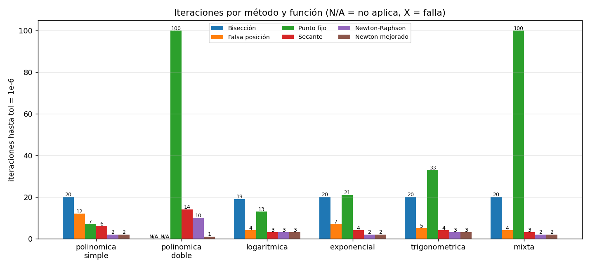
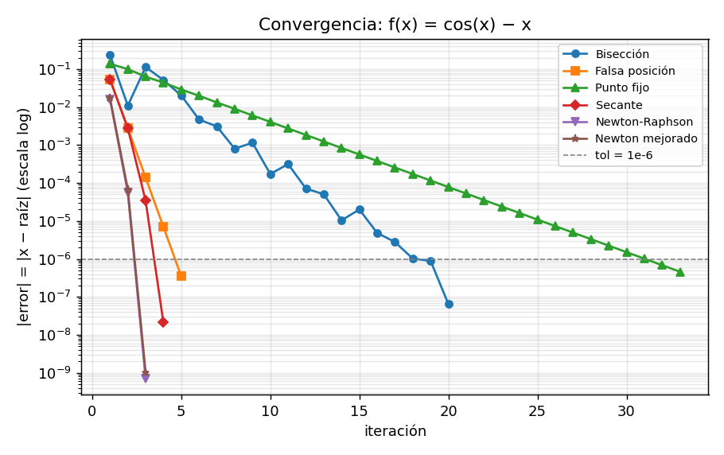
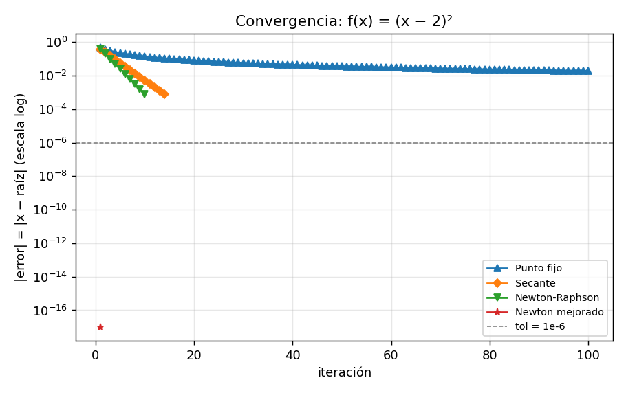

# Informe — La raíz que se esconde

**Integrante:** Gonzalo Jaque Barros
**Tolerancia:** 1e-6 · **Máximo de iteraciones:** 100
*Todos los números de este informe salen de los archivos de `src/data/`.*

## 1. Cómo se armó la prueba

Para comparar los métodos usé seis funciones de tipos distintos. La Tabla 1 muestra desde dónde parte cada método y si se cumple el teorema de Bolzano, que dice que si una función cambia de signo entre a y b (es decir, f(a)·f(b) < 0), entonces hay una raíz en ese intervalo.

**Tabla 1.** Funciones y condiciones iniciales.

| Función | Tipo | Intervalo [a, b] | f(a) | f(b) | f(a)·f(b) | x₀ (Newton / punto fijo) | x₀ ; x₁ (secante) |
|---|---|---|---|---|---|---|---|
| x³ − x − 2 | Polinómica simple | [1, 2] | −2 | 4 | −8 (cumple) | 1,5 | 1,0 ; 2,0 |
| (x − 2)² | Polinómica doble | [1, 3] | 1 | 1 | 1 (no cumple) | 1,2 | 1,2 ; 1,3 |
| ln(x) + x − 4 | Logarítmica | [2, 3] | −1,307 | 0,099 | −0,129 (cumple) | 2,5 | 2,0 ; 3,0 |
| e^(−x) − x | Exponencial | [0, 1] | 1 | −0,632 | −0,632 (cumple) | 0,5 | 0,0 ; 1,0 |
| cos(x) − x | Trigonométrica | [0, 1] | 1 | −0,460 | −0,460 (cumple) | 0,5 | 0,0 ; 1,0 |
| √x − cos(x) | Mixta | [0,1 ; 1] | −0,679 | 0,460 | −0,312 (cumple) | 0,5 | 0,1 ; 1,0 |

Cinco funciones cruzan el eje x, así que se sabe que tienen raíz en su intervalo. La excepción es (x − 2)²: la curva solo toca el eje en x = 2 y nunca pasa a negativo, por eso f(1)·f(3) es positivo y Bolzano no aplica. Es una raíz doble. Los gráficos están en `src/assets/funcion_*.png`.

Para el método de punto fijo hay que reescribir la ecuación como x = g(x). Usé: (x+2)^(1/3), x + 0,5(x−2)², 4 − ln(x), e^(−x), cos(x) y cos²(x).

## 2. Resultados

Corrí los seis métodos en cada función con tolerancia 1e-6. La Tabla 2 muestra cuántas iteraciones necesitó cada uno.

**Tabla 2.** Iteraciones hasta cumplir la tolerancia.

| Función | Bisección | Falsa posición | Punto fijo | Secante | Newton | Newton mejorado |
|---|---|---|---|---|---|---|
| Polinómica simple | 20 | 12 | 7 | 6 | **2** | **2** |
| Polinómica doble | no aplica | no aplica | 100 (no converge) | 14* | 10* | **1** |
| Logarítmica | 19 | 4 | 13 | **3** | **3** | **3** |
| Exponencial | 20 | 7 | 21 | 4 | **2** | **2** |
| Trigonométrica | 20 | 5 | 33 | 4 | **3** | **3** |
| Mixta | 20 | 4 | 100 (no converge) | 3 | **2** | **2** |

\*En la raíz doble, la secante y Newton se detienen porque |f(x)| ya es menor que la tolerancia, pero el error real sigue en unos 7,8·10⁻⁴. Se explica en la sección 3.4.

Cómo baja el error en cada iteración se ve en `src/assets/convergencia_<función>.png`. Dos ejemplos:

## 3. Análisis

### 3.1 ¿Qué método fue más rápido y por qué?

Newton y Newton mejorado fueron los más rápidos casi siempre: 2 iteraciones en la polinómica simple, la exponencial y la mixta, y 3 en la logarítmica y la trigonométrica (en la logarítmica empatan con la secante). En la raíz doble, Newton mejorado la resolvió en una sola iteración.

Esto pasa porque Newton usa la derivada, o sea la pendiente de la curva, para saber hacia dónde apuntar, y con eso cada paso duplica más o menos la cantidad de decimales correctos. La bisección, en cambio, solo parte el intervalo por la mitad en cada paso, así que necesita unas 20 iteraciones (log₂(1/10⁻⁶) ≈ 19,9). La falsa posición (4 a 12 iteraciones) y el punto fijo (7 a 100) dependen mucho de la forma de cada función.

### 3.2 Orden de convergencia

El orden de convergencia indica qué tan rápido se achica el error. Con los datos de `resumen_convergencia.csv`, lo que salió coincide con la teoría:

* **Bisección:** lineal, el error se reduce a la mitad en cada paso. En el gráfico logarítmico se ve como una recta.
* **Falsa posición y punto fijo:** también lineales (orden estimado ≈ 1,00). En punto fijo, qué tan rápido converge depende de |g′(r)|, que mide cuánto se achica el error en cada paso.
* **Secante:** entre 1,52 y 1,68, cerca del valor teórico de 1,618.
* **Newton y Newton mejorado:** cuadrático, con un orden estimado de 2,00 en la logarítmica y la trigonométrica.

En el gráfico, los métodos lineales bajan en línea recta, mientras que los rápidos caen cada vez más fuerte. Por ejemplo, Newton baja el error de ~10⁻¹ a ~10⁻¹⁰ en tres pasos. Ojo: cuando un método converge en solo 2 o 3 pasos hay muy pocos datos para estimar el orden, y la cifra sale poco confiable (en la mixta, la secante dio 2,4). En esos casos conviene fijarse más en el gráfico.

En punto fijo, la velocidad la marcó |g′(r)|: 0,14 en la polinómica (7 iteraciones), 0,34 en la logarítmica (13), 0,57 en la exponencial (21), 0,67 en la trigonométrica (33) y 0,96 en la mixta, donde no alcanzó la tolerancia en 100 iteraciones. No diverge, pero avanza tan despacio que no llega.

### 3.3 ¿Qué métodos necesitan cambio de signo?

Bisección y falsa posición (los métodos cerrados) sí lo necesitan: sin f(a)·f(b) < 0 no pueden partir. Por eso en (x − 2)² marcan "no aplica". Punto fijo, secante, Newton y Newton mejorado (los abiertos) solo piden un punto de partida, pero no aseguran converger si ese punto está lejos de la raíz.

### 3.4 La raíz doble (x − 2)²

1. **Bisección y falsa posición:** no se pueden usar, porque no hay cambio de signo.
2. **Punto fijo:** no logró converger en 100 iteraciones y quedó con un error de 1,9·10⁻². Aquí g′(2) = 1, así que el avance es demasiado lento.
3. **Newton y secante:** convergen, pero solo de forma lineal (orden ≈ 1,00). Además, los dos se detienen antes de tiempo. El programa para cuando |f(x)| < 10⁻⁶, pero como f(x) = (x − 2)², eso ocurre cuando x está a menos de 10⁻³ de la raíz. El método "dice" que terminó, pero el error real queda cerca de 7,8·10⁻⁴, unas 780 veces más que la tolerancia pedida.
4. **Newton mejorado:** resolvió el caso en 1 iteración, con x = 2 exacto. Su fórmula, x − f·f′ / (f′² − f·f″), corrige el efecto de la raíz múltiple. Aquí da exacto porque la función es de segundo grado; en otras funciones con raíz múltiple recupera la rapidez de Newton, aunque sin necesariamente caer exacto.

### 3.5 Qué pasa al cambiar el punto de partida

Con los datos de `sensibilidad.csv`:

* **Bisección** (x³ − x − 2): al agrandar el intervalo de [1, 2] a [−1000, 1000], solo subió de 20 a 31 iteraciones. Crece muy poco aunque el intervalo sea enorme.
* **Falsa posición:** con [1, 2] necesitó 12 iteraciones, pero con [−10, 10] y con [−1000, 1000] no convergió en 100. Un extremo del intervalo queda casi fijo y el otro avanza muy despacio.
* **Newton** (x³ − x − 2): desde x₀ = 1,5, 5 y 50 necesitó 2, 7 y 12 iteraciones. Si parte cerca de donde la derivada vale 0 (x ≈ ±0,577), el primer paso sale disparado y se necesitan 18, 37 y 31 iteraciones (con x₀ = 0,58, 0,5 y −1).
* **Newton** (cos(x) − x): desde x₀ = 0,5 necesitó 3 iteraciones. Con x₀ = 4,7, donde la derivada es casi cero, el método salió disparado a −2·10⁹ y falló. Con x₀ = 10 se alejó de la raíz (terminó en x ≈ 65) y no convergió en 100 iteraciones.
* **Punto fijo** (mixta, g = cos²(x)): da lo mismo partir de 0,1 que de 3. En todos los casos llegó a 100 iteraciones sin converger, porque |g′(r)| ≈ 0,96 hace el avance lentísimo sin importar el inicio.

### 3.6 ¿Qué método conviene en cada caso?

* **Raíz simple, con derivada disponible y buen punto de partida:** Newton-Raphson. Resuelve en 2 o 3 pasos.
* **Si no se tiene la derivada:** secante. Rinde casi igual (3 a 6 iteraciones) y solo necesita evaluar la función.
* **Funciones con dominio restringido o derivada que cambia mucho (logarítmica, mixta):** falsa posición con un intervalo bien acotado, o Newton con un punto de partida cercano. En la logarítmica, la falsa posición lo resolvió en 4 iteraciones.
* **Sin un buen punto de partida, o cuando se necesita seguridad total:** bisección. Es lenta pero no falla si hay cambio de signo.
* **Raíz doble o múltiple:** Newton mejorado. Fue el único que la resolvió bien, sin caer en la parada prematura.
* **Punto fijo:** solo si se logra elegir una g(x) con |g′(r)| bastante menor que 1.

Una estrategia práctica es combinar ambas cosas: usar bisección 3 o 4 pasos para acotar la raíz y terminar con Newton o secante.

## 4. Conclusiones

1. **Velocidad frente a seguridad.** Newton y la secante resuelven en pocos pasos lo que a la bisección le toma unos 20, pero son sensibles al punto de partida: un mal x₀ cerca de una derivada casi nula los puede hacer fallar, como pasó con cos(x) − x. La bisección es lenta, pero siempre llega si hay cambio de signo, incluso con un intervalo de [−1000, 1000] (31 iteraciones). La falsa posición, aunque suele ser rápida, no resultó más segura que la bisección: con [−10, 10] ni siquiera convergió.
2. **Tener raíz no es lo mismo que cambiar de signo.** La función (x − 2)² tiene raíz en x = 2, pero como no cambia de signo, la bisección y la falsa posición quedan fuera. Bolzano garantiza que hay raíz cuando hay cambio de signo, pero no al revés. Además, Newton y la secante se vuelven lentos y se detienen con un error unas 780 veces mayor al que se pedía. Con raíces múltiples, un método adaptado como Newton mejorado es la opción adecuada.
3. **El punto de partida importa.** Agrandar el intervalo apenas afectó a la bisección (de 20 a 31 iteraciones), pero la falsa posición pasó de 12 a no converger. En los métodos abiertos, partir cerca de un punto de tangente horizontal fue lo que más provocó fallos, y en punto fijo lo que decidió todo fue |g′(r)|, no el x₀.
